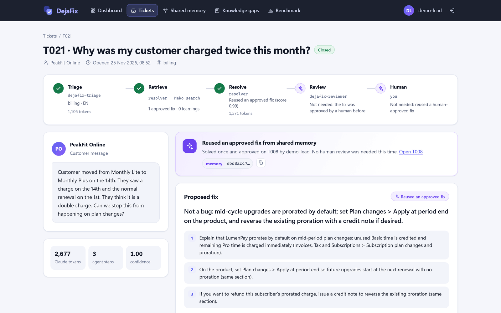
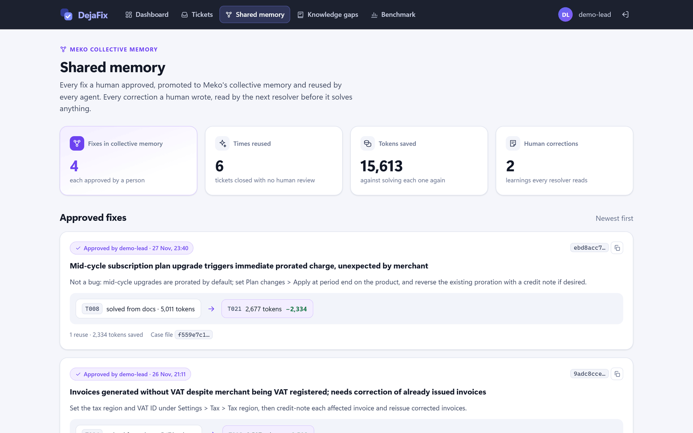
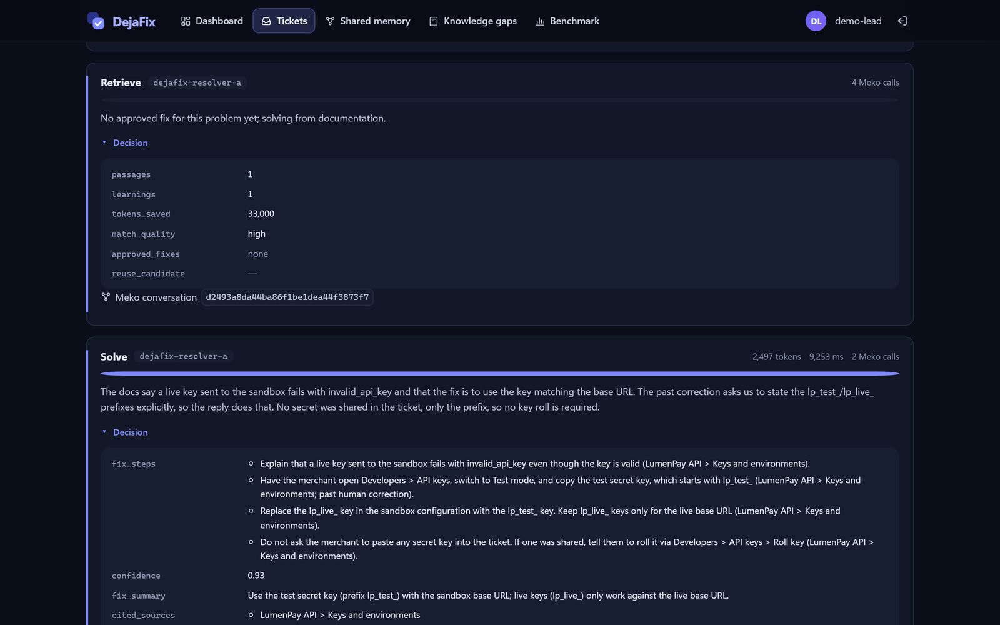
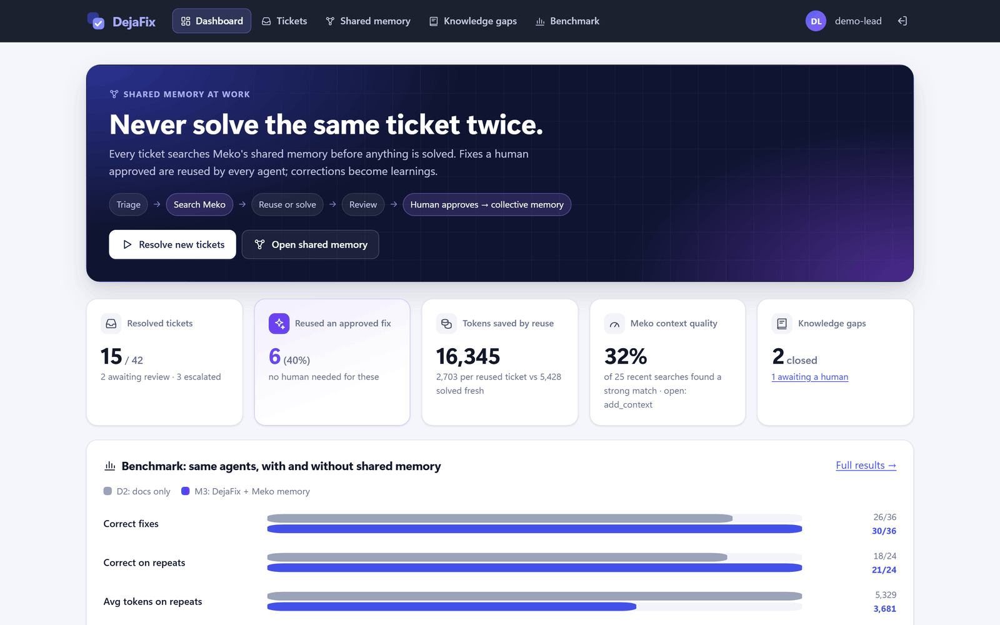

# DejaFix: never solve the same ticket twice

[](https://github.com/MhmoodHmmam/dejafix/actions/workflows/tests.yml)

A multi-agent support team built on the [Meko Context Engine](https://mekodata.ai) for
**ContextCon: Remember Everything**, Challenge 02 "Never Solve It Twice".

Support teams solve the same problem again and again, because every agent starts from zero.
DejaFix's Claude agents share one memory in Meko:

- **Search before solving.** A resolver searches Meko's shared memory and knowledge base before
  it writes a single word.
- **Humans decide what is remembered.** A fix becomes collective memory only after a person
  approves it. A rejection note becomes a learning the next resolver reads.
- **Every decision explains itself.** Each step is a Meko conversation turn with its reasoning and
  token usage. Each human decision leaves a case file as a Meko artifact.
- **It finds its own gaps.** Meko grades every search. A librarian agent drafts the missing
  articles, and Meko's replay shows whether they helped.

## Tour in 60 seconds

All four screenshots are the running app, with real Claude and Meko runs from 2026-11-27.

**A repeat problem, solved from shared memory.** T021 reused the fix a human approved on T008:
no reviewer agent, no human review, 2,677 tokens instead of 5,011. The pipeline strip shows each
stage, and the purple card links back to where the fix was approved.



**The shared memory, in one place.** Every human-approved fix in Meko's collective memory, who
approved it, which tickets reused it and the tokens each reuse saved, plus every human correction.



**Every step explains itself.** Each agent step is a turn in a Meko conversation, with its
reasoning, tokens and decision. Here T015's resolver read one human correction (`learnings: 1`)
before solving. Dark mode follows the system.



**The dashboard.** Reuse rate, tokens saved, Meko's live context quality, knowledge gaps, and the
benchmark against a docs-only baseline.



## Results

Same agents, same 36 synthetic tickets, each arm in its own fresh Meko datapack: two docs-only
runs and three Meko runs (run 1 / 2 / 3, [full report](docs/benchmark.md)). Run 3 came after the
week 11 fix to how corrections are retrieved.

| | Docs only | DejaFix + Meko shared memory |
|---|---|---|
| Correct fixes, of 36 | 25 / 26 | **30 / 28 / 30** |
| Correct on repeat tickets, of 24 | 17 / 18 | **22 / 19 / 21** |
| Avg tokens on repeat tickets | 5,348 / 5,329 | **3,537 / 3,670 / 3,681** (about −31% to −34%) |
| Tickets a human had to handle, of 36 | 36 / 36 | **19 / 20 / 19** |
| Next ticket correct after a human correction | – | 3 of 3 / 1 of 4 / **2 of 3** |
| Lookalike tickets correct, of 6 (runs 2 and 3) | 4 | **6 / 6** |
| Wrong reuse / injection tickets stored | 0 / 0 of 2 | 0 / 0 of 2 |

**Lookalikes** (T037–T042) read like one issue but are caused by another, for example a payout
that arrived on time but short (the currency fee, not the weekend delay). With shared memory,
5 of 6 (run 2) and 6 of 6 (run 3) reused the approved fix for their *real* issue, and none reused
the fix they resemble.
**Is the reuse threshold safe?** [docs/reuse-margin.md](docs/reuse-margin.md) measures it. Searching
with each ticket's English problem signature, as the resolver does, no other issue's fix came back
for any of the 42 tickets. Searching with the raw ticket text, which keeps the misleading words,
one lookalike (T037, a short payout) brought back the weekend-delay fix at 0.90, above the 0.80
threshold. So the threshold alone is not the guard: the triage signature and the reuse check after
it are, and in the run that ticket reused the right fix.

**Learning from corrections.** In run 2 only 1 of 4 tickets after a rejection was right. The cause
was retrieval: memories Meko extracts from every conversation turn filled `context_search`'s five
memory slots, so the human correction never reached the resolver. A dedicated `memory_search` now
finds it first, the reviewer sees it, and a fix must say how it applied it. In run 3 every
correction was followed; 2 of 3 next tickets were fully right, and the third (T015) named the
`lp_live_` prefix the note asked for but left out `lp_test_`, which the note didn't mention.

## Documentation

| Doc | What |
|---|---|
| [docs/architecture.md](docs/architecture.md) | Diagrams of a ticket's path and the self-learning loop, components, agent identities |
| [docs/meko-usage.md](docs/meko-usage.md) | Every Meko tool DejaFix calls, where and why, what we learned about Meko Cloud, and what we don't use |
| [docs/benchmark.md](docs/benchmark.md) | The benchmark, per ticket, with the reuse-threshold calibration |
| [docs/demo-script.md](docs/demo-script.md) | The demo video, scene by scene |
| [docs/decision-log.md](docs/decision-log.md) | Each design decision and the sources it was checked against |
| [docs/submission.md](docs/submission.md) | The submission text: summary, results, Meko use by judging criterion, links |

## Try it without API keys

The recorded runs, with every agent step, the shared memory, the knowledge gaps and the benchmark,
load into a fresh SQLite database, so you can browse the whole app with no Anthropic or Meko account.
The **Run the agents** button then explains which keys are missing.

```powershell
python -m venv .venv
.\.venv\Scripts\python.exe -m pip install -r requirements.txt
.\.venv\Scripts\python.exe manage.py migrate
.\.venv\Scripts\python.exe manage.py load_demo
.\.venv\Scripts\python.exe manage.py createsuperuser
.\.venv\Scripts\python.exe manage.py runserver --insecure
```

## Setup (Windows PowerShell)

You need Python 3.14, an [Anthropic API key](https://console.anthropic.com/) and a
[Meko Cloud](https://cloud.mekodata.ai) account. The commands below are for PowerShell; on Linux
or macOS use `.venv/bin/python` instead of `.\.venv\Scripts\python.exe`.

```powershell
python -m venv .venv
.\.venv\Scripts\python.exe -m pip install -r requirements.txt
Copy-Item .env.example .env   # then fill in the keys
```

`.env` needs:

| Variable | What |
|---|---|
| `CLAUDE_API_KEY` | Anthropic API key |
| `MEKO_API_KEY` | Meko Cloud API key |
| `MEKO_DATAPACK_ID` | UUID of a datapack you created in the Meko Cloud portal |

The datapack must be created in the portal: over MCP, `conversation_create` needs a datapack
and `datapack_create` needs a conversation.

**Database (optional).** By default Django uses a local SQLite file. To keep the app's state in
a Postgres cluster that Meko manages in the same datapack, create it with your public IP, then
migrate:

```powershell
.\.venv\Scripts\python.exe manage.py provision_db --allow-cidr <your public IP>/32
.\.venv\Scripts\python.exe manage.py migrate
```

`provision_db` writes the `DEJAFIX_DB_*` settings to `.env` and never prints the password. Any
other Postgres works too: set the variables in `.env.example` yourself. TLS is required. See
[docs/meko-usage.md](docs/meko-usage.md#postgres-amp-the-apps-own-database).

## Check the Meko connection

```powershell
.\.venv\Scripts\python.exe manage.py meko_probe --smoke
```

This lists Meko's tools, saves their live input schemas to `docs/meko-tools.json`, and calls
the read-only `datapack_list` inside a reusable probe conversation.

## Run it

```powershell
.\.venv\Scripts\python.exe manage.py migrate
.\.venv\Scripts\python.exe manage.py load_tickets          # 42 synthetic tickets
.\.venv\Scripts\python.exe manage.py seed_knowledge --wait # docs -> Meko knowledge base
.\.venv\Scripts\python.exe manage.py resolve_tickets T001  # calls Claude + Meko
.\.venv\Scripts\python.exe manage.py createsuperuser
.\.venv\Scripts\python.exe manage.py runserver --insecure # staff pages at /, admin at /admin/
```

Then open http://127.0.0.1:8000/ and log in as a staff user:

| Page | What it shows |
|---|---|
| `/` | Reuse rate, tokens saved, Meko's live context quality, knowledge gaps, benchmark bars |
| `/tickets/<ref>/` | A five-stage pipeline strip (triage, retrieve, resolve, review, human), the customer message, the proposed fix, where a reused fix came from (and which tickets reused this one), and every agent step with its reasoning, tokens and Meko conversation. Buttons: **Run the agents** (with a live timer), **Approve and share**, **Reject with a note** |
| `/memory/` | The shared memory: every human-approved fix in Meko's collective memory, who approved it, the tickets that reused it and the tokens each reuse saved, and every human correction the resolvers learn from |
| `/gaps/` | Weak searches from Meko's self-learning log; edit, publish or dismiss the librarian's drafts |
| `/benchmark/` | Docs-only vs DejaFix + Meko, per ticket |

Approving a fix stores it as the curator's memory and promotes it to the datapack's collective
memory, so repeat tickets reuse it. **Run the agents** waits for Claude and Meko (15 to 30 s) inside
the request: fine for a local demo, not for production, where a task queue would run it.

With `DJANGO_DEBUG` off (the default), add `--insecure` to `runserver` so it serves the CSS and
JavaScript locally. The pages follow the system's light or dark theme, work at phone width, and work
without JavaScript; `app.js` only adds the live timer, double-submit protection and copy buttons.
The Content-Security-Policy allows scripts and styles from our own static files only.

For a real deployment rather than the local demo:
- set `DJANGO_SECRET_KEY`, so sessions survive restarts and work across several workers;
- set `DJANGO_HTTPS=1` for secure cookies, an HTTPS redirect and HSTS (`manage.py check --deploy` is then clean, apart from the subdomain and preload options that only the domain owner can choose);
- put the login behind your SSO or a proxy that rate-limits it, because Django has no built-in login throttling.

## How a ticket flows

1. **Triage** (`dejafix-triage`): category, an English problem signature, and an injection flag.
2. **Retrieve** (resolver): `context_search`, `memory_search` (human corrections) and `knowledgebase_search`, always before solving.
3. **Resolve**:
   - If a curator-approved fix scores 0.80 or more, a low-effort check decides whether it applies.
   - Otherwise the resolver solves from the documentation.
4. **Review** (`dejafix-reviewer`): checks the fix against the policy, the resolver's evidence and
   the past human corrections. Code rules can only make the verdict stricter: a fix that was given
   corrections but doesn't say how it follows them goes to a human flagged.
5. **Human** (the ticket page, or the Django admin):
   - Approve: the curator promotes the fix to collective memory.
   - Reject with a note: the note becomes a learning the next resolver reads.

Every step is a Meko conversation turn with `reasoning`, `plan` and token usage (`track_token_usage`).
Every human decision also stores a **case file** (the agents' steps, reasoning and scores, with no
ticket text or names) as a Meko artifact. The shared memory links to it (`Case file: <sha256>`).

## The self-learning loop

Meko grades every `context_search`. DejaFix uses those grades to find and close its own knowledge gaps:

```powershell
.\.venv\Scripts\python.exe manage.py find_gaps            # weak searches by our resolvers (read-only)
.\.venv\Scripts\python.exe manage.py draft_gap_articles   # librarian drafts from human-approved fixes (calls Claude)
# /gaps/ (or admin > Knowledge gaps): edit the draft, then publish it to the Meko knowledge base
.\.venv\Scripts\python.exe manage.py verify_gaps          # replay each search: band before -> after
```

`verify_gaps` also records what the replay ranked first and where the article ranks in the
knowledge base. Meko's grade counts past conversations too, so a better band alone doesn't prove
the article helped.

## Benchmark: with and without shared memory

The same agents run over all 42 tickets (36 core, then 6 lookalikes) in both arms, each arm in its
own fresh datapack with the same documentation. The only difference is Meko's shared memory.
Results: [docs/benchmark.md](docs/benchmark.md). D1 and M1 ran before the lookalikes existed, so
they cover the 36 core tickets; D2, M2 and M3 cover all 42.

```powershell
.\.venv\Scripts\python.exe manage.py benchmark_setup D1 --arm docs_only   # creates and seeds a datapack
.\.venv\Scripts\python.exe manage.py benchmark_setup M1 --arm meko
.\.venv\Scripts\python.exe manage.py benchmark D1                         # resumable; --limit N for batches
.\.venv\Scripts\python.exe manage.py benchmark M1
.\.venv\Scripts\python.exe manage.py benchmark_report D1 D2 M1 M2         # writes docs/benchmark.md
```

- **Grading:** each issue has ground-truth keywords in `data/tickets.json`. The agents never see them.
- **Simulated reviewer:** in the Meko arm, a reviewer approves or rejects each new fix right away. Its
  rejection notes name the missing keywords, so it is a kinder reviewer than a busy human.

## Tests

```powershell
.\.venv\Scripts\python.exe manage.py test
```

Tests never touch the network. They run against an in-process fake of Meko's MCP server
(`dejafix/tests/fakes.py`) that follows the real server's reply conventions. They also use SQLite
even when `.env` points Django at Postgres. Set `DEJAFIX_TEST_ON_POSTGRES=1` to run them on your
Postgres instead (slower: every query crosses the network).

## Layout

| Path | Purpose |
|---|---|
| `dejafix/meko/` | Meko gateway: MCP connection, schema-checked calls, agent/conversation/datapack scoping, timeouts, retries for reads only, call records |
| `dejafix/agents/` | Agents: schemas, prompts, retrieval, traces, workflow, self-learning (`knowledge.py`), case files (`casefile.py`) |
| `dejafix/llm.py` | Claude wrapper: typed output, effort, refusal fallback, usage |
| `dejafix/bench.py` | Benchmark grading, simulated reviewer, reuse-threshold calibration |
| `support/` | Django app: models, services, staff pages (`views.py`, `templates/`), admin, management commands |
| `data/` | Synthetic LumenPay knowledge base and tickets (LumenPay is a made-up payments company) |
| `docs/` | Architecture, Meko usage, benchmark, demo script, decision log |
| `docs/meko-tools.json` | Live Meko tool schemas (generated by `meko_probe`) |

## License

[MIT](LICENSE)
