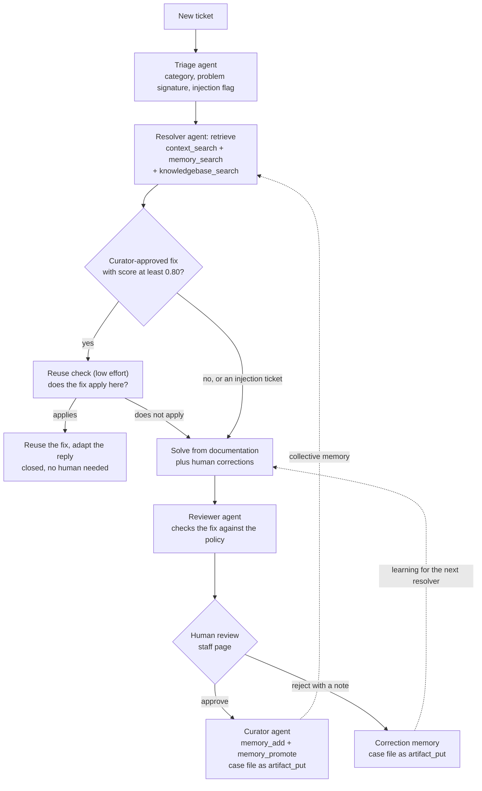
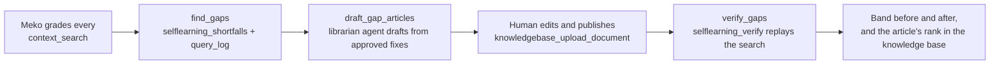

# DejaFix architecture

DejaFix is a Django app that runs a small team of Claude agents. All memory lives in Meko: the
agents share what they learn through one Meko datapack. Django keeps a copy of each ticket's
outcome for the staff pages and the benchmark, in SQLite or in a Postgres cluster that Meko
manages in the same datapack.

## A ticket's path

- **The order is fixed in code.** A model can't skip "search before solving", and code rules can
  only make the reviewer's verdict stricter (injection, low confidence, escalation).
- **Only humans create durable memory.** The agents read and leave traces. A fix becomes shared
  memory only after a person approves it. A rejection note becomes a learning.
- **Trust is checked on every read.** A promoted fix is reused only if the curator agent wrote it
  in the expected format. A correction is used only if the human-review agent wrote it. Tickets
  that try to instruct the agents never take the reuse path.

## The self-learning loop

Meko's grade also counts past conversations, so a better band alone doesn't prove the article
helped. `verify_gaps` records where the article itself ranks.

## Components

| Part | Code | Role |
|---|---|---|
| Meko gateway | `dejafix/meko/` | One MCP session per job. Sets `agent_id` and `conversation_id` in code, not by the model. Checks arguments against the live tool schemas. Timeouts on every call, retries for reads only. Records each call without its arguments. |
| Agents | `dejafix/agents/` | Triage, two resolvers, reviewer, curator, librarian. Typed outputs (Pydantic schemas), prompts, retrieval, traces, case files. |
| LLM wrapper | `dejafix/llm.py` | Claude `claude-opus-5-5` with structured output and an effort level per step (low for triage, reuse check, review; medium for solving). |
| Django app | `support/` | Tickets, resolutions, agent runs, knowledge gaps, benchmark runs. Staff pages, admin, management commands. |
| Benchmark | `dejafix/bench.py`, `support/benchmark.py` | Docs-only vs Meko arms in separate datapacks, keyword grading, a simulated reviewer, threshold calibration. |

## Agents and their Meko identities

| Agent (`agent_id`) | Writes to Meko | Reads from Meko |
|---|---|---|
| `dejafix-triage` | A conversation turn with its reasoning and token usage | – |
| `dejafix-resolver-a`, `dejafix-resolver-b` | Turns for retrieve, reuse check and solve | Memories, past conversations, knowledge base |
| `dejafix-reviewer` | Its verdict turn | Policy chunks from the knowledge base |
| `dejafix-curator` | Approved fixes (`memory_add`, then `memory_promote`) and case files | – |
| `dejafix-human-review` | Human corrections and case files | – |
| `dejafix-librarian` | Knowledge-base articles that close gaps | Weak searches and approved fixes |

The two resolvers matter for the shared-memory story: in the benchmark they take turns, and in 7 of
the 17 reuses the fix had been approved on a ticket the other resolver solved.

## Request handling on the staff pages

- Server-rendered templates, one stylesheet, no JavaScript. A strict Content-Security-Policy
  blocks all scripts (the Django admin is exempt).
- Staff only, with a change permission per action. CSRF on every form.
- 400 for invalid input, 409 for a state conflict (for example, approving twice), 502 when Meko or
  Claude fails. Nothing is stored after a failure.
- **Run the agents** claims the ticket (`running`) and returns at once. A two-thread pool in the web
  process runs the agents after the claim commits, and the ticket page polls
  `/tickets/<ref>/progress/` for each finished step. Tests and management commands run inline.
